# Memories

Everyone at a family event shoots into one shared album, and an AI director turns it into two finished reels from one sentence in Hindi.

Built for Festive Hacks 2026 (WeMakeDevs x WeAreDevelopers, Bengaluru).

## The problem

Diwali night. Four phones in one family take hundreds of photos and videos. They end up spread across one WhatsApp group, compressed. Nobody finds the good ones. Nobody has the time or the skill to edit them into something you want to post. Next week the moment is gone.

The same thing happens at weddings, and at events like this hackathon.

## What it does (20 seconds)

1. **Join.** Open the event in the Memories app. Everyone's photos land in one shared album.
2. **Shoot with a shot coach.** The app tells you what the album is missing, for example "No photo of Dadi with the kids yet" or "Rangoli, before guests walk on it".
3. **Say what you want.** Speak in Hindi, English or Hinglish: "WA status ke liye family wali, thoda emotional".
4. **Get two reels.** The director picks the moments and gives you two different cuts, each with a one-line reason.
5. **Share.** Save the reel or send it to WhatsApp or Instagram.

## Demo video

Watch the demo: https://vimeo.com/1249984018

## Live demo (offline)

The live server ran on an Azure VM during Festive Hacks 2026 (25 to 26 Nov 2026). We shut it down and deleted it after the event, so the server links, the director studio and the judge invite code no longer work.

- Telegram channel with reels that Memories posted during the event: https://t.me/memories_family_demo_4336
- To run your own copy, follow [Setup](#setup) and [`deploy/`](deploy/).

## Install the app

Android only. The APK is still on the release page, but it needs a Memories server. With no server of your own, it cannot log in.

- APK: https://github.com/saurabh4269/memories/releases/download/v0.1.0-festive-hacks/memories-0.1.0.apk
- Release page: https://github.com/saurabh4269/memories/releases/tag/v0.1.0-festive-hacks

After you set up your own server, open the app, enter your server URL and log in.

## Screenshots

From the Memories app on an Android emulator, talking to the live server during the event.

| Album with the reel button | Make a reel | Two cuts from the director | Under the hood |
|---|---|---|---|
| 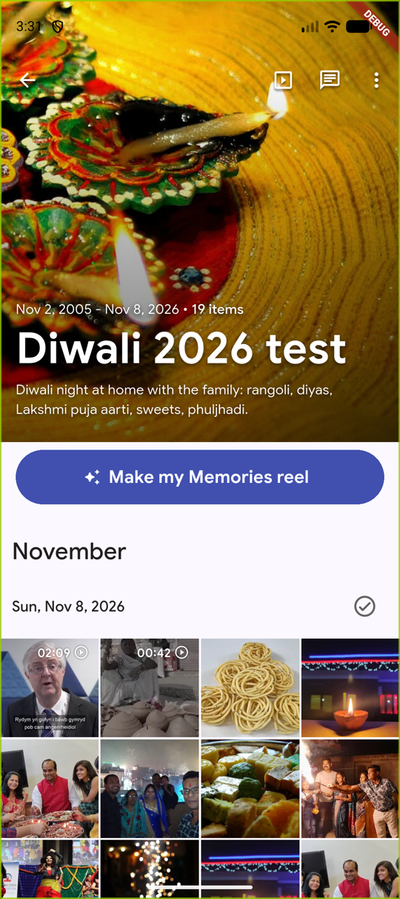 | 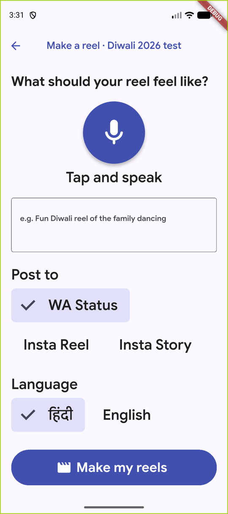 | 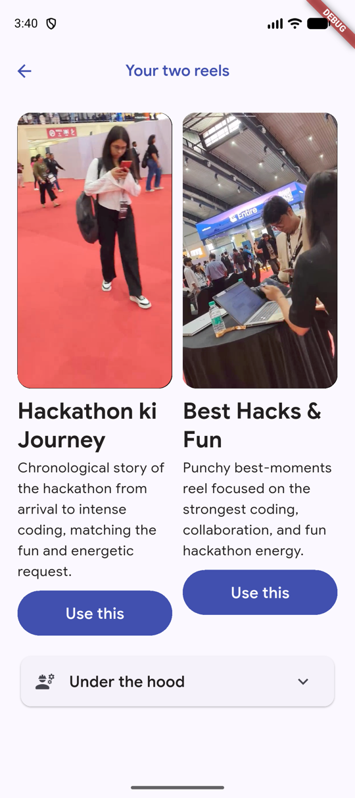 | 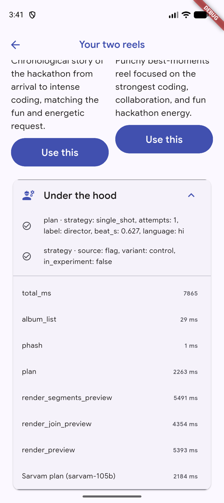 |

The last screenshot is the trace the app shows for every reel: which director strategy ran, the Flagsmith variant, and the time of each stage.

## What works today

We mark each part honestly. "Built" means the code is in this repo and we ran it against the live server during the event. "In progress" means the code exists but is not finished, not wired in, or not tested end to end yet.

**Director service (`server/src/memories/`)**

| Feature | Status | Code |
|---|---|---|
| Reel from a text prompt: two cuts, previews, speculative finals, trace | Built | [`pipeline.py`](server/src/memories/pipeline.py), [`api.py`](server/src/memories/api.py) |
| Shot analysis with gemma4, video contact sheets, background poller every 10 s | Built | [`analysis.py`](server/src/memories/analysis.py) |
| Agentic director (sarvam-105b with tools) and single-shot director, picked by Flagsmith | Built | [`agentic.py`](server/src/memories/agentic.py), [`director.py`](server/src/memories/director.py), [`flags.py`](server/src/memories/flags.py) |
| Edit grammar and QA checks applied to every cut (hook, ending, lengths, captions in the safe area) | Built | [`grammar.py`](server/src/memories/grammar.py), [`qa.py`](server/src/memories/qa.py), [docs/EDIT-GRAMMAR.md](docs/EDIT-GRAMMAR.md) |
| Team detection (recurring faces + activity + CLIP search) for hackathon albums | Built | [`team.py`](server/src/memories/team.py) |
| ffmpeg renderer: parallel segments, segment cache, captions in Indian scripts | Built | [`render.py`](server/src/memories/render.py), [`captions.py`](server/src/memories/captions.py) |
| Voice prompt to intent (Dictate, saaras:v4 fallback), invite card reading, voiceover, translation | Built (server API) | [`extras_api.py`](server/src/memories/extras_api.py), [`dictate.py`](server/src/memories/dictate.py), [`invite.py`](server/src/memories/invite.py), [`voiceover.py`](server/src/memories/voiceover.py) |
| Shot coach cards, in Hindi for beta members (Flagsmith `shot_coach` segment) | Built (server API, live) | [`coach.py`](server/src/memories/coach.py) |
| Editor API: EDL for live preview, media proxy, swap or trim clips and re-render, alternatives (`/edl`, `/edit`, `/alternatives`, `/otio`, `/v1/assets/*`) | Built (live) | [`editor_api.py`](server/src/memories/editor_api.py) |
| OpenTimelineIO export of a cut | Built | [`otio_export.py`](server/src/memories/otio_export.py) |
| Event join: invite code, QR page, redeem into an Immich user and album (`/v1/join/*`) | Built (live) | [`join_api.py`](server/src/memories/join_api.py) |
| Post a finished reel to a public Telegram channel through a self-hosted Postiz | Built. A real reel went end to end: `POST /director/v1/reels/{id}/post`, then Postiz, then the [Telegram channel](https://t.me/memories_family_demo_4336) through a bot. | [`postiz_api.py`](server/src/memories/postiz_api.py) |
| Facet photo scores (aesthetics, sharpness, blinks, duplicates) as an extra signal for the director | Built. The Facet container runs on the VM and the director reads its scores per album. Scores are not loaded for the demo album yet. | [`facet_scores.py`](server/src/memories/facet_scores.py), [`facet_api.py`](server/src/memories/facet_api.py), [`grammar.py`](server/src/memories/grammar.py) |
| Voiceover mixed into the rendered reel | Not built. Voiceover is a separate audio file today. | |

**Memories app (fork of the Immich Flutter app, [`app/`](app/))**

| Feature | Status |
|---|---|
| Everything Immich already does: login, timeline, shared albums, background backup | Built (upstream Immich) |
| "Make my Memories reel" button on an album, Make a reel page (prompt, destination, language) | Built |
| Two cuts page with video previews, one-line reasons and the Under the hood trace | Built |
| Share a cut through the Android share sheet, which sends `reel_shared` to Flagsmith | Built |
| Speak the prompt (voice prompt button) | In the app, wired to `/v1/extras/voice-prompt` |
| Live preview player from the EDL, reel editor | In the app, wired to the editor endpoints |
| Camera with shot coach cards (camera code adapted from LibreCamera) | In the app (camera tab and album button) |
| QR join, elder mode, post to socials sheet | In the app |

"In the app" means the module is in [`app/mobile/lib/memories/`](app/mobile/lib/memories/) and wired into the app's screens. The screenshots above only cover the reel flow, so these features are not shown there yet. The [app diagram](docs/architecture/app-light.svg) shows which endpoint each module calls.

## How each sponsor tool does real work

Take any one of these tools out and a main part of Memories stops working. Every "verified" result below comes from a live run on 2026-11-25 against the real APIs.

### Sarvam AI: the director's eyes, ears, brain and voice

| Feature | What it does in Memories | Code | Verified result |
|---|---|---|---|
| Document AI (Extract) | Reads a photo of the printed invite card. It returns the event, hosts, family names, venue and ceremonies with date and time. sarvam-105b then writes the shot list for that event. | [`invite.py`](server/src/memories/invite.py) `process_invite` (`POST /v1/extras/invite`), [`sarvam.py`](server/src/memories/sarvam.py) `doc_extract` | Hindi wedding invite (JPEG): names, hosts, Dadi/Nani, venue and 4 ceremonies with ISO date and 24h time, plus English ceremony names. About 10.6 s end to end. |
| Dictate (`/v2/dictate`) with saaras:v4 fallback | Turns the spoken request into text and a JSON intent (people, include, exclude, mood, music, destination) in one call. Family names and words like "रील" go in as vocabulary. If Dictate fails, saaras:v4 transcribes with keyterms and sarvam-105b extracts the intent. | [`dictate.py`](server/src/memories/dictate.py) `voice_intent` (`POST /v1/extras/voice-prompt`), [`pipeline.py`](server/src/memories/pipeline.py) `voice_prompt` | Dictate PASS, 2.4 to 5.4 s. saaras:v4 with keyterms PASS, 1.7 to 3.3 s. Without vocabulary, ASR heard "रील" (reel) as "व्हील" (wheel) every time. The vocabulary fixed it. |
| sarvam-105b agentic director | Works like an editor. It calls tools over the album (`search_moments`, `list_people`, `assets_with`, `shot_details`), then calls `submit_edit` with two cuts. Our code validates every asset id and time. | [`agentic.py`](server/src/memories/agentic.py), [`director.py`](server/src/memories/director.py) | PASS 2 of 2 runs with `reasoning_effort: "low"`: parallel tool calls, then a valid `submit_edit` in round 2 that respected the exclusions. Round 1: 1.5 to 2.2 s, round 2: 4.4 to 4.9 s. With `reasoning_effort: null` it was flaky, so we use `low` and cap the rounds. |
| gemma4 on Sarvam (shot scoring) | Scores 6 images per call: caption, scene, mood, quality 1 to 10, blur, group or not. Videos go in as one contact sheet each. **gemma4 is an open model that Sarvam hosts. Sarvam did not train it.** | [`analysis.py`](server/src/memories/analysis.py), [`sarvam.py`](server/src/memories/sarvam.py) `analyse_images` | 6 inline JPEGs in one call with strict `json_schema`: one schema-valid result, the blurred photo scored quality 1, shot types correct. 5.3 to 6.0 s per call. |
| bulbul:v4-flash voiceover | Speaks a short voiceover for a reel, and a spoken "your reel is ready" for elders, in 11 Indian languages. Uses the streaming endpoint. | [`voiceover.py`](server/src/memories/voiceover.py) `synthesize`, `confirmation` (`POST /v1/extras/voiceover`, `/v1/extras/confirmation`) The voiceover is a separate audio file for now. It is not mixed into the rendered reel yet. | Streaming endpoint: first audio byte in 0.8 to 2.0 s (median about 1.1 s). The REST endpoint took 8.4 s for a 12 s clip. |
| mayura:v1 translation | Translates coach cards, tips and captions into the member's language. | [`coach.py`](server/src/memories/coach.py) `coach_cards`, [`voiceover.py`](server/src/memories/voiceover.py) `translate` (`POST /v1/extras/translate`) | <!-- TODO: measured mayura latency and a sample coach card in Hindi --> TODO |

All Sarvam calls go through one client with a rate limiter per model, retries with backoff on 429, and a clear error on 402 (out of credits).

### Flagsmith: progressive delivery for the AI pipeline

| Feature | What it does in Memories | Code | Verified result |
|---|---|---|---|
| `director_strategy` experiment | A real product question: does the agentic director make reels people share more? Control `single_shot`, variation `agentic`. Bucketed by member id. The metric is `reel_shared`, sent when someone taps Share. | [`flags.py`](server/src/memories/flags.py) `director_strategy`, `track`; [`api.py`](server/src/memories/api.py) `POST /v1/reels/{id}/shared` | Experiments PASS on the free plan (flag, metric, experiment, SDK exposures and events). `get_experiment_flag` about 350 ms. Exposures only appear after `start`. <!-- TODO: exposure and reel_shared counts from the demo experiment --> |
| `elder_mode` segment | A segment on traits `language = hi-IN` AND `role = elder` gets a JSON override (bigger UI, Hindi voice). | Flagsmith segment `elders_hindi` <!-- TODO: link the Flutter code that reads elder_mode --> | PASS on the Edge API and Python SDK: elder + hi-IN got the override, every other combination got the default. Live on edge about 3 s after the change. |
| `shot_coach` staged rollout | Turns the shot coach on and sets `max_cards`. The coach also turns itself off when `ml_lite_mode` says so. | [`coach.py`](server/src/memories/coach.py) `coach_cards` | Flag and value read by the coach. Live: a beta-member segment gets Hindi coach cards, other members get none. <!-- TODO: % rollout split and screenshot --> |
| `ml_lite_mode` kill switch | NudgeBee turns it on after a human approves. Memories then turns off the shot coach, sends 3 images per vision call instead of 6, and uses cached analysis instead of live smart search. | [`flags.py`](server/src/memories/flags.py) `ml_lite`; [`coach.py`](server/src/memories/coach.py); [`api.py`](server/src/memories/api.py) analyse | Flipped by the NudgeBee workflow in the live run. Approval to flag visible on the Edge API: 6 s. |
| Feature Health | NudgeBee marks `shot_coach` UNHEALTHY with its root-cause text, so the Flagsmith dashboard shows why the feature is degraded. | [`memories-ml-surge.workflow.yaml`](deploy/nudgebee/memories-ml-surge.workflow.yaml) task `mark_shot_coach_unhealthy` | Webhook call PASS in 0.6 s. In the live loop, `shot_coach` went UNHEALTHY about 2 s after approval and back to healthy on restore. |
| `render_profile` and `peak_mode` remote config | JSON values that change render settings with no redeploy. `peak_mode` wins over `render_profile`. | [`flags.py`](server/src/memories/flags.py) `render_overrides`; [`render.py`](server/src/memories/render.py) `profile_from` | <!-- TODO: verify peak_mode JSON keys match profile_from (flag holds res/fps/transition, code reads transitions and final/preview) --> TODO |

Every flag has a safe default in code, so Memories keeps working if Flagsmith is unreachable. Flags are cached for 15 s.

### NudgeBee: the stack survives Diwali night, with a human in the loop

Immich machine learning (face detection and CLIP search) is the part that struggles when a whole family uploads at once. So it runs in k3s, and NudgeBee watches it.

| Feature | What it does in Memories | Code | Verified result |
|---|---|---|---|
| Agent on k3s (Azure VM) | The NudgeBee agent runs in namespace `nudgebee-agent` and streams cluster events out over 443. No inbound port. | [`deploy/k8s/immich-ml.yaml`](deploy/k8s/immich-ml.yaml) | Cluster connected; OOM events show up in NudgeBee. |
| OOM under an upload surge | A burst of 100 photos (16 parallel) runs face detection and CLIP at concurrency 16. Immich ML runs out of memory. | [`deploy/surge/`](deploy/surge/) `burst.sh`, `loop.sh` | Container OOMKilled 10 s after the burst started. NudgeBee HIGH event `pod_oom_killer_enricher` about 2 s after the OOM. |
| AI investigation | NudgeBee finds the root cause and shows the evidence. | NudgeBee cloud | Event to `investigation.completed` and workflow start: about 3 min 46 s. |
| Workflow `memories-ml-surge` | Triggers on `investigation.completed` for HIGH OOM events in namespace `immich`. A human approves in NudgeBee. Then it PATCHes Flagsmith `ml_lite_mode` ON and POSTs Feature Health for `shot_coach`. | [`memories-ml-surge.workflow.yaml`](deploy/nudgebee/memories-ml-surge.workflow.yaml) | One execution per OOM (the filter ignores the CrashLoopBackOff event that follows). Flagsmith PATCH 200. Approval to flag on the Edge API: 6 s. |

Live run, take 1 (2026-11-25, times in UTC):

| Step | Time | Delta |
|---|---|---|
| Burst starts (100 photos, all HTTP 201 in 2 s) | 09:11:05 | |
| Immich ML container OOMKilled | 09:11:15 | 10 s after the burst |
| NudgeBee HIGH event | 09:11:17 | about 2 s after the OOM |
| Investigation completed, workflow waits for approval | 09:15:03 | about 3 min 46 s after the event |
| Approval | about 09:15:12 | |
| `shot_coach` marked UNHEALTHY | 09:15:14 | |
| Flagsmith Edge API shows `ml_lite_mode=true` | 09:15:18 | 6 s after approval |
| Restore: flag off, limit back to 2Gi, `shot_coach` healthy | 09:15:25 | |

Calibration: under a 100-photo burst the ML working set is about 0.9 GiB (anonymous memory). With the normal 2Gi limit there is no OOM. For the demo we set the limit to 700Mi. Details in [`deploy/surge/README.md`](deploy/surge/README.md).

## Architecture

<a href="https://saurabh4269.github.io/memories/architecture/">
<picture>
  <source media="(prefers-color-scheme: dark)" srcset="docs/architecture/memories-architecture-dark.svg">
  
</picture>
</a>

**[Open the interactive version](https://saurabh4269.github.io/memories/architecture/)**: click any box to open a diagram of what is inside it, and use Back to return. The small arrow in the corner of a box means it has a deeper diagram.

How to read it:
- **Boxes inside boxes are deployment boundaries.** The phone, the Azure VM (Standard_D16as_v5, centralindia), and the outside services. Inside the VM: docker compose for Immich, and single-node k3s for Immich ML, the NudgeBee agent and the director (namespace `memories`, host network on 127.0.0.1:8018). Only ports 22, 80 and 443 are open on the VM. Caddy is the only public entry point.
- **Numbers on the arrows follow one reel:** 1 the phone backs up photos and videos to Immich. 2 Immich makes thumbnails and runs faces and CLIP in Immich ML. 3 the poller analyses new assets with gemma4 (6 images per call), and Facet adds photo scores. 4 the member asks for a reel. 5 Dictate turns a spoken prompt into an intent. 6 Flagsmith picks the director strategy and sarvam-105b plans with tools over Immich. 7 our code validates the edit list (EDL). 8 segments render in parallel from the originals. 9 two previews come back and the finals render in the background. 10 share through the Android share sheet, or post through Postiz to the Telegram channel. 11 `reel_shared` goes to Flagsmith as the experiment metric.
- **Solid arrows** are calls someone waits on. **Dashed arrows** are background work (Immich ML jobs, the poller, Facet scores). **Red arrows** are the ops path: the NudgeBee agent dials out over wss 443, and after a human approves, NudgeBee turns on `ml_lite_mode` in Flagsmith.
- **The three sponsor tools are marked SPONSOR.** Sarvam AI is split into the models doing the work.

The ops loop when a family uploads at once:

<picture>
  <source media="(prefers-color-scheme: dark)" srcset="docs/architecture/ops-loop-dark.svg">
  
</picture>

### Zoom in

Each part of the overview has its own diagram. The links in the first column open the interactive page; the images also expand below.

| Part | What it shows | Image |
|---|---|---|
| [Immich](https://saurabh4269.github.io/memories/architecture/immich.html) | server, job queues (thumbnails, transcode, faces, CLIP), Immich ML in k3s, Postgres with VectorChord, Valkey, albums and shared links, workflows | [light](docs/architecture/immich-light.svg) / [dark](docs/architecture/immich-dark.svg) / [PNG](docs/architecture/immich-light.png) |
| [Director service](https://saurabh4269.github.io/memories/architecture/director.html) | routers, reel pipeline, analysis poller, team score, Facet scores, agentic director, grammar and QA, renderer with segment cache and speculative finals, editor, join, Postiz bridge, SQLite | [light](docs/architecture/director-light.svg) / [dark](docs/architecture/director-dark.svg) / [PNG](docs/architecture/director-light.png) |
| [Android app](https://saurabh4269.github.io/memories/architecture/app.html) | Immich fork modules and the `lib/memories` modules, with the server endpoints each one calls | [light](docs/architecture/app-light.svg) / [dark](docs/architecture/app-dark.svg) / [PNG](docs/architecture/app-light.png) |
| [Sarvam AI](https://saurabh4269.github.io/memories/architecture/sarvam.html) | each model and the job it does in Memories | [light](docs/architecture/sarvam-light.svg) / [dark](docs/architecture/sarvam-dark.svg) / [PNG](docs/architecture/sarvam-light.png) |
| [Flagsmith](https://saurabh4269.github.io/memories/architecture/flagsmith.html) | each flag, segment and the experiment, and where the code reads it | [light](docs/architecture/flagsmith-light.svg) / [dark](docs/architecture/flagsmith-dark.svg) / [PNG](docs/architecture/flagsmith-light.png) |
| [NudgeBee ops loop](https://saurabh4269.github.io/memories/architecture/ops-loop.html) | upload surge, OOM, investigation, human approval, Flagsmith kill switch | [light](docs/architecture/ops-loop-light.svg) / [dark](docs/architecture/ops-loop-dark.svg) / [PNG](docs/architecture/ops-loop-light.png) |

<details>
<summary><b>Immich</b>: server, job queues (thumbnails, transcode, faces, CLIP), Immich ML in k3s, Postgres with VectorChord, Valkey, albums and shared links, workflows</summary>

<picture>
  <source media="(prefers-color-scheme: dark)" srcset="docs/architecture/immich-dark.svg">
  
</picture>

</details>

<details>
<summary><b>Director service</b>: routers, reel pipeline, analysis poller, team score, Facet scores, agentic director, grammar and QA, renderer with segment cache and speculative finals, editor, join, Postiz bridge, SQLite</summary>

<picture>
  <source media="(prefers-color-scheme: dark)" srcset="docs/architecture/director-dark.svg">
  
</picture>

</details>

<details>
<summary><b>Android app</b>: Immich fork modules and the `lib/memories` modules, with the server endpoints each one calls</summary>

<picture>
  <source media="(prefers-color-scheme: dark)" srcset="docs/architecture/app-dark.svg">
  
</picture>

</details>

<details>
<summary><b>Sarvam AI</b>: each model and the job it does in Memories</summary>

<picture>
  <source media="(prefers-color-scheme: dark)" srcset="docs/architecture/sarvam-dark.svg">
  
</picture>

</details>

<details>
<summary><b>Flagsmith</b>: each flag, segment and the experiment, and where the code reads it</summary>

<picture>
  <source media="(prefers-color-scheme: dark)" srcset="docs/architecture/flagsmith-dark.svg">
  
</picture>

</details>

<details>
<summary><b>NudgeBee ops loop</b>: upload surge, OOM, investigation, human approval, Flagsmith kill switch</summary>

<picture>
  <source media="(prefers-color-scheme: dark)" srcset="docs/architecture/ops-loop-dark.svg">
  
</picture>

</details>

All diagrams were made with [Archify](https://github.com/tt-a1i/archify) from the JSON sources in [`docs/architecture/`](docs/architecture/) (for example [`memories-architecture.json`](docs/architecture/memories-architecture.json)). Each has light and dark SVGs and a 2x PNG. The interactive pages are the `.html` files in the same folder, served with GitHub Pages at https://saurabh4269.github.io/memories/architecture/.

More detail, including the step-by-step flow of a reel request and the speed work: [docs/ARCHITECTURE.md](docs/ARCHITECTURE.md).

## Built on open source

Memories stands on years of other people's work. We did not change the Immich server.

| Project | What we use it for | Licence |
|---|---|---|
| [Immich](https://github.com/immich-app/immich) server and machine learning | Shared albums, upload, dedupe, EXIF, face clustering, CLIP smart search, per-asset metadata | AGPL-3.0 |
| [Immich Flutter app](https://github.com/immich-app/immich/tree/main/mobile) | Base of the Memories app (our fork) | AGPL-3.0 |
| [FFmpeg](https://ffmpeg.org/) | All video work: keyframes, segments, transitions, music | LGPL-2.1+ (GPL-2.0+ for builds with GPL parts, such as the Debian package with libx264) |
| [libass](https://github.com/libass/libass) and [HarfBuzz](https://github.com/harfbuzz/harfbuzz) | Correct shaping of Devanagari and Tamil text (see [ARCHITECTURE](docs/ARCHITECTURE.md#captions-in-indian-scripts)) | ISC (libass), MIT (HarfBuzz) |
| [Pillow](https://github.com/python-pillow/Pillow) with libraqm | Caption images and photo canvases | MIT-CMU |
| [FastAPI](https://github.com/fastapi/fastapi), [httpx](https://github.com/encode/httpx), [uvicorn](https://github.com/encode/uvicorn) | The director service | MIT, BSD-3-Clause, BSD-3-Clause |
| [Flagsmith Python SDK](https://github.com/Flagsmith/flagsmith-python-client) | Flags, experiment, events | See upstream |
| [k3s](https://github.com/k3s-io/k3s) | Single-node Kubernetes for Immich ML | Apache-2.0 |
| [OpenTimelineIO](https://github.com/AcademySoftwareFoundation/OpenTimelineIO) | Export a cut as a timeline other editors can open | Apache-2.0 |
| [Postiz](https://github.com/gitroomhq/postiz-app) (self-hosted, not modified) | Posting reels to our Telegram channel | AGPL-3.0 |
| [Facet](https://github.com/ncoevoet/facet) | Photo scoring (runs as its own container, not modified) as an extra signal for the director | MIT |
| [LibreCamera](https://github.com/iakmds/librecamera) | Camera lifecycle, zoom and focus code adapted for the Memories camera (in progress) | GPL-3.0-or-later |
| [qrcode](https://github.com/lincolnloop/python-qrcode) | QR codes for event join | BSD-3-Clause |
| [Caddy](https://github.com/caddyserver/caddy) | HTTPS reverse proxy | Apache-2.0 |
| [Noto fonts](https://github.com/notofonts) | Caption fonts (Latin, Devanagari) | SIL OFL 1.1 |
| Music by Kevin MacLeod ([incompetech.com](https://incompetech.com)) | Reel soundtracks, attribution per track in [`server/assets/music/CREDITS.md`](server/assets/music/CREDITS.md) | CC BY 4.0 |
| "Night Build" track | A dev-vibe track for hackathon reels. **AI-generated** with ElevenLabs Music, not composed by a person. See [`CREDITS.md`](server/assets/music/CREDITS.md). | Generated on our ElevenLabs account |
| Wikimedia Commons photos | Test photos for the surge script only | CC0 or public domain |
| [Archify](https://github.com/tt-a1i/archify) | The architecture diagrams in this README (tooling only, not part of the app) | Apache-2.0 |

## Setup

You need a Linux machine with Docker (we use an Azure VM: Standard_D16as_v5, 16 vCPU, 64 GB, Ubuntu 24.04. It was a D8as_v5 with 8 vCPU and 32 GB when we ran the benchmarks in docs/ARCHITECTURE.md), plus accounts and keys for Sarvam AI, Flagsmith and NudgeBee. No secret values are in this repo.

### 1. Clone

```bash
git clone https://github.com/saurabh4269/memories.git
cd memories
```

### 2. Immich (docker compose)

Follow the [official Immich docker compose install](https://docs.immich.app/install/docker-compose). We used `/opt/immich` and Immich v3.4.2:

```bash
sudo mkdir -p /opt/immich && cd /opt/immich
sudo wget -O docker-compose.yml https://github.com/immich-app/immich/releases/latest/download/docker-compose.yml
sudo wget -O .env https://github.com/immich-app/immich/releases/latest/download/example.env
# in .env: set IMMICH_VERSION=v3.4.2, DB_PASSWORD, UPLOAD_LOCATION
sudo docker compose up -d
curl -s http://127.0.0.1:2283/api/server/ping   # {"res":"pong"}
```

Create the admin user in the web UI, then an API key (Account settings, API keys). In the Immich admin settings, turn OCR off. Keep CLIP and facial recognition on.

Optional: put Caddy in front for HTTPS (reverse proxy to `127.0.0.1:2283`, large max body, no body timeouts for big videos).

### 3. k3s and Immich ML

```bash
curl -sfL https://get.k3s.io | sh -s - --disable traefik
export KUBECONFIG=/etc/rancher/k3s/k3s.yaml

# run Immich ML in k3s (fills the version and model cache path)
V=$(grep ^IMMICH_VERSION= /opt/immich/.env | cut -d= -f2)
sed "s/__IMMICH_VERSION__/$V/; s#__CACHE_PATH__#/opt/immich-ml-cache#" deploy/k8s/immich-ml.yaml | kubectl apply -f -
kubectl -n immich rollout status deploy/immich-machine-learning
```

Point the Immich server at it and stop the compose ML container:

```bash
cd /opt/immich
echo "IMMICH_MACHINE_LEARNING_URL=http://<machine-private-ip>:30003" | sudo tee -a .env
sudo tee docker-compose.override.yml >/dev/null <<'EOF'
services:
  immich-machine-learning:
    profiles: ["compose-ml"]
EOF
sudo docker compose up -d
```

To roll back: delete the override file, remove the env line, and run `docker compose up -d`.

(If you work from a laptop, [`deploy/k8s/apply-ml.sh`](deploy/k8s/apply-ml.sh) does the same over SSH through [`deploy/vm.sh`](deploy/vm.sh). Change the host in `vm.sh` first.)

### 4. NudgeBee agent

In NudgeBee: Admin, Integrations, Kubernetes Clusters. Create the account (mark it non-production) and copy the agent key. On the machine:

```bash
wget https://raw.githubusercontent.com/nudgebee/k8s-agent/main/installation.sh
bash installation.sh -a <agent-key> -d true    # -d true: eBPF node agent off
kubectl -n nudgebee-agent logs deploy/nudgebee-agent-runner | grep 'relay connected'
```

### 5. Flagsmith

Create a project and these features in the Development environment. Values are JSON strings.

| Feature | Type | Default | Value |
|---|---|---|---|
| `director_strategy` | Multivariate | on | control `single_shot`, option `agentic` (key `agentic`) |
| `elder_mode` | Remote config | off | segment override for `language = hi-IN` AND `role = elder` |
| `shot_coach` | Flag + value | off | `{"max_cards": 3}` |
| `ml_lite_mode` | Flag + value | off | `{"shot_coach": false, "analysis_batch": 3, "smart_search": "cached"}` |
| `render_profile` | Remote config | on | `{"res": 1080, "fps": 30, "transition": "xfade"}` |
| `peak_mode` | Flag + value | off | `{"res": 720, "fps": 24, "transition": "cut", "cuts": 1}` |

<!-- TODO: add a flags setup script (deploy/flagsmith_setup) so this step is one command -->

Then:
- Create the metric `reel_shared` (aggregation `occurrence`, direction up) and an experiment on `director_strategy` with a 50% `agentic` split. Start it.
- Create a Feature Health provider of type Webhook (Project settings). Keep its webhook URL secret.
- Our ids are in [`deploy/flagsmith_features.json`](deploy/flagsmith_features.json). Yours will differ. Change the feature id `303496` (`ml_lite_mode`) in the workflow file to yours.

### 6. NudgeBee workflow

Store two NudgeBee secrets: `flagsmith_api_key` (Flagsmith organisation API key) and `flagsmith_health_webhook` (the Feature Health webhook URL). Then, with [`nbctl`](https://docs.nudgebee.com) and `NUDGEBEE_ENDPOINT=https://app.nudgebee.com` plus your NudgeBee API credentials in the environment:

```bash
R=$(mktemp); sed "s/__FLAGSMITH_ENV_KEY__/$FLAGSMITH_ENV_KEY/" deploy/nudgebee/memories-ml-surge.workflow.yaml > $R
nbctl workflow validate $R && nbctl workflow apply $R   # new workflows start PAUSED
nbctl workflow list                                     # copy the id
nbctl workflow resume <workflow-id>
```

To run the surge loop yourself, see [`deploy/surge/README.md`](deploy/surge/README.md). `AUTO_APPROVE=0 RESTORE=0 deploy/surge/run.sh` stops at the approval so you can approve in the NudgeBee UI. The scripts expect our VM host and a `~/.memories.env` on the VM. Change both for your machine.

### 7. Director service

```bash
cd server
cp .env.example .env    # fill in SARVAM_API_KEY, FLAGSMITH_SERVER_KEY, IMMICH_URL, IMMICH_API_KEY, PUBLIC_BASE_URL
docker build -t memories-director .
docker run --network host --env-file .env -v /srv/director:/data memories-director
curl -s http://127.0.0.1:8000/health
```

Without Docker: `uv sync && uv run uvicorn memories.api:app --port 8000`. On macOS, Pillow builds from source so it links libraqm: `brew install libraqm fribidi` and export CFLAGS/LDFLAGS for `/opt/homebrew`.

Try one reel from the command line:

```bash
uv run python -m memories.demo --album <album-id> --prompt "WA status ke liye family wali, thoda emotional" --dest wa_status --final -v
```

Tests: `uv run pytest -q`. A small web page for testing is at `http://<host>:8000/studio`.

On our VM the director runs in k3s (namespace `memories`, hostNetwork on `127.0.0.1:8018`; redeploy with [`deploy/director-redeploy.sh`](deploy/director-redeploy.sh)) and Caddy sends `https://<host>/director/*` to it, so the app and the studio use `https://<host>/director` as the base URL. The API is described in [docs/API-CONTRACT.md](docs/API-CONTRACT.md).

### 8. Flutter app

The app is a fork of the Immich Flutter app, in [`app/`](app/) (see [`app/NOTICE.md`](app/NOTICE.md) for the upstream commit). Flutter 3.47.9, pinned in `app/mobile/mise.toml`. Set up the build tools with the [Immich developer setup guide](https://docs.immich.app/developer/setup).

<!-- TODO: link to the fork repo and the exact build commands (codegen, flutter run / APK build), and where to set the director URL -->

## Honesty notes

- **The surge is staged.** A script uploads 100 photos with Immich job concurrency raised to 16, and the ML memory limit is set to 700Mi, below the measured working set of about 0.9 GiB. Normal settings are a 2Gi limit and concurrency 2. The OOM, the NudgeBee event, the investigation, the approval and the Flagsmith change are all real.
- **The investigation is sped up in the video.** In the live run it took about 3 min 46 s from event to completed investigation. The video says so where it is cut.
- **In the scripted loop, the approval is an API call** (`workflow_complete_approval`), the same action as the button in the NudgeBee UI. In the demo we press the button.
- **Experiment traffic is small.** The `director_strategy` experiment has only demo traffic from a few people, some of it synthetic. It shows the wiring, not a statistically valid result.
- **gemma4 is not a Sarvam model.** It is an open model that Sarvam hosts on its API. The Sarvam-built models we use are sarvam-105b, saaras, bulbul and mayura, plus Document AI and Dictate.
- **The NudgeBee eBPF node agent is off.** Events come from the Kubernetes API watcher.
- **Our k3s cluster reports as `festive-kind`** in NudgeBee, an account name from an earlier local cluster.
- **Test media.** Surge photos are CC0 or public-domain images from Wikimedia Commons, with random bytes added so Immich dedupe does not skip them. The reel demo uses real photos and videos we shot ourselves. <!-- TODO: confirm which album the demo uses -->
- **Flagsmith audit log.** We do not show it. It is a paid feature and was empty on our plan.

## AI assistance disclosure

We used AI coding assistants, as the rules allow. Claude Code and other coding agents wrote much of the code in this repo, the deploy scripts and these docs. They also ran many of the live sponsor checks and benchmarks for us.

The team chose the problem, designed the product and the architecture, decided what to build and what to drop, reviewed the code, and checked the live test results. We understand the code and can explain any part of it.

## Team

- Saurabh Gupta

## Licence

AGPL-3.0, because Memories builds on Immich (AGPL-3.0). See [LICENSE](LICENSE).
