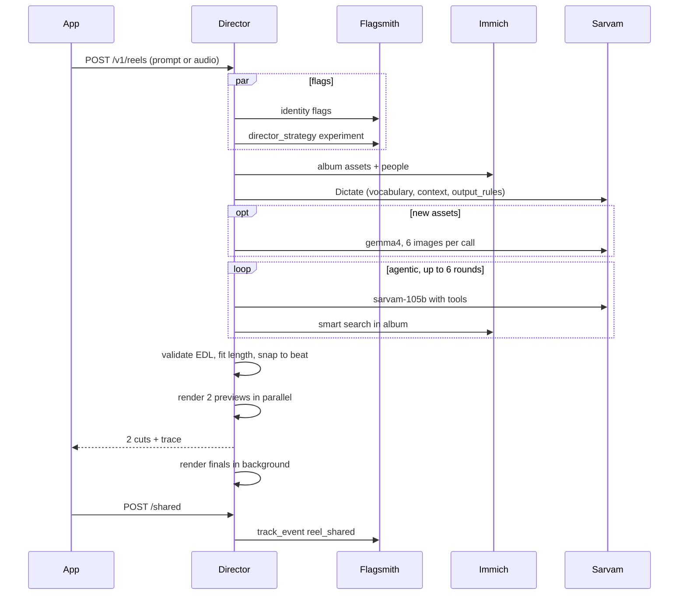
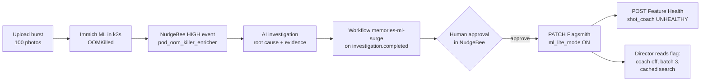

# Memories architecture

This page explains how Memories works inside: the parts, the path of one reel request, and the work we did to make it fast. Measured numbers come from our runs on 2026-11-25. Where we have no measurement yet, there is a TODO.

## Parts

| Part | Where it runs | Job |
|---|---|---|
| Memories app | Phones | Fork of the Immich Flutter app. Join an event, shoot, see coach cards, ask for a reel, share. |
| Immich server v3.4.2 | Azure VM, docker compose (`/opt/immich`) | Media backend: shared albums, uploads, dedupe, EXIF, thumbnails, people, smart search, per-asset metadata. Not modified. |
| Immich machine learning | k3s on the same VM, namespace `immich` | Face detection and CLIP. 2Gi limit, 1Gi request, model TTL 300 s. NodePort 30003. |
| NudgeBee agent | k3s, namespace `nudgebee-agent` | Sends cluster events to NudgeBee over 443. |
| Memories director | Same VM, Docker (`server/`) | FastAPI service. Analysis, coach, director, renderer. Talks to Immich, Sarvam and Flagsmith. |
| Sarvam AI | Cloud | Doc AI, Dictate, saaras:v4, sarvam-105b, gemma4 (hosted open model), bulbul:v4-flash, mayura:v1. |
| Flagsmith | Cloud | Flags, the `director_strategy` experiment, Feature Health. |
| NudgeBee | Cloud | Investigation, workflow `memories-ml-surge`, human approval. |

VM: Azure `centralindia`, Ubuntu 24.04, 8 vCPU (AMD), 32 GB, 256 GB Premium SSD. Caddy terminates HTTPS for Immich.

### Director modules (`server/src/memories/`)

| Module | Job |
|---|---|
| `api.py` | HTTP routes: `/v1/reels`, `/v1/reels/{id}/final/{cut}`, `/v1/reels/{id}/shared`, `/v1/albums/{id}/analyse`, `/v1/albums/{id}/coach`, `/v1/events/{id}/invite`, `/v1/flags`, `/health`, `/studio` |
| `extras_api.py` | Sarvam extras under `/v1/extras`: `invite`, `voice-prompt`, `voiceover`, `confirmation`, `translate`, `voices`. Every response carries per-call timings. |
| `invite.py` | Invite card: Document AI extract, then a sarvam-105b shot list, cached by image hash |
| `dictate.py` | Voice prompt to intent: Dictate, with saaras:v4 plus sarvam-105b as fallback |
| `voiceover.py` | bulbul:v4-flash streaming voiceover, elder confirmation, mayura:v1 translation (cached) |
| `pipeline.py` | One reel job from request to previews, then the speculative finals |
| `analysis.py` | Shot analysis with gemma4, video contact sheets, cache, background poller |
| `director.py` | Single-shot director prompt, EDL validation, length fitting, beat snapping, fallback plan |
| `agentic.py` | Tool-calling director on sarvam-105b |
| `render.py` | ffmpeg segments in parallel, xfade join, music, cover |
| `captions.py` | Caption PNGs with Pillow and libraqm |
| `coach.py` | Shot list, missing-shot cards, invite reading |
| `flags.py` | Flagsmith client with safe defaults and a 15 s cache |
| `sarvam.py` | One Sarvam client: rate limit per model, retries, error types |
| `immich.py` | Immich REST client |
| `db.py` | SQLite cache (analysis, faces, reels, shot lists) |
| `timing.py` | Per-request trace: stages, Sarvam calls, events |

## A reel request, step by step

The member taps the mic and says "WA status ke liye family wali, thoda emotional".

1. **Request.** The app sends `POST /v1/reels` with `album_id`, `destination` (`wa_status`, `insta_reel` or `insta_story`), `member_name`, and either a text `prompt` or an `audio` file (multipart).
2. **Flags, in parallel.** The director asks Flagsmith for the member's identity flags and for the `director_strategy` experiment value (`single_shot` or `agentic`). The member name is the identifier, so a member always gets the same variant.
3. **Album.** It lists the album's assets from Immich (with people names) and joins them with the cached analysis from SQLite.
4. **Voice.** If there is audio, Sarvam Dictate turns it into text and a JSON intent. We send a vocabulary (family names, "रील" with "व्हील" as a sounds-like, Diwali and wedding words) and a short context. If Dictate fails, saaras:v4 transcribes with the same words as keyterms. The intent ("people", "exclude", "music") is added to the prompt.
5. **Analysis, bounded.** Assets without analysis get analysed now, with a 45 s budget. Usually the background poller has done this already (see [incremental analysis](#speed)). If the budget runs out, the director plans with what it has.
6. **Director.**
   - `agentic`: sarvam-105b with tools `search_moments` (Immich CLIP search inside the album), `list_people`, `assets_with`, `shot_details` and `submit_edit`. `reasoning_effort` is `low`. After 4 free rounds we force `submit_edit`; the limit is 6 rounds. If the agent fails, we fall back to single-shot and record that in the trace.
   - `single_shot`: one sarvam-105b call with a compact table of shots (alias, time, people, caption, quality, mood, video length and best window). Up to 2 attempts.
   - The model sees short aliases (`A1`, `A2`, ...) instead of Immich ids. It writes a small edit list (EDL): two cuts, each with clips, captions, a music mood and a cover.
7. **Validation in code.** We drop unknown ids and low-quality shots, clamp video in/out points, snap photo holds to the music beat, remove near-duplicates and fit the destination length. If no valid director cut is left, a deterministic plan is used and labelled "auto". The model never writes ffmpeg commands.
8. **Music.** Each cut gets a track by mood from `server/assets/music/tracks.json` (Kevin MacLeod, CC BY 4.0), with its BPM and beat offset.
9. **Preview render.** Both cuts render at the same time at 540x960, 24 fps (see [rendering](#rendering)).
10. **Response.** The app gets both cuts with title, one-line reason, preview URL, cover, and a trace: the stages with times, every Sarvam call, the director's tool calls, and the flag values.
11. **Speculative finals.** Right after the response, the director starts rendering both cuts at 1080x1920, 30 fps in the background. When the member taps "Use this one", `POST /v1/reels/{id}/final/{cut}` usually returns a file that is already done. A lock stops double renders.
12. **Share.** The app calls `POST /v1/reels/{id}/shared`. The director sends `reel_shared` to Flagsmith for that member, which is the experiment's metric.

<!-- TODO: measured end-to-end time from request to two previews on the demo album, and to finals -->

## Shot analysis

- **Photos:** the director downloads Immich's preview JPEG (and keeps it for the renderer), shrinks it to 768 px, and sends 6 per gemma4 call. The response follows a strict JSON schema: caption, scene, mood, quality 1 to 10, blur, group, subject centre, moment tag.
- **Videos:** see contact sheets below.
- **Duplicates:** shots from the same uploader within 3 s count as a burst. Only the first is analysed. The others copy its analysis with quality 1 lower, so the director prefers the first.
- **Results** are stored in SQLite and in the Immich asset metadata under the key `memories`, so a second director instance can reuse them.

## Shot coach

1. **Shot list.** sarvam-105b writes 6 to 10 must-have shots for the event (Diwali: rangoli, diyas, aarti, sweets, phuljhadi, family group). It uses the album name and, if present, the invite details from Sarvam Document AI. There is a built-in Diwali list if the call fails. (The invite flow in `invite.py` also writes its own shot list from the invite.)
2. **Coverage.** Each shot is checked with Immich smart search in the album and with keywords in our captions. People coverage comes from Immich faces: who has only 1 photo, and which of the top people were never photographed together.
3. **Cards.** Up to `max_cards` (from the `shot_coach` flag, default 3) missing items become cards, translated with mayura:v1 into the member's language.
4. **Lite mode.** When `ml_lite_mode` is on, the coach shows its last cached cards (or uses only cached analysis instead of live smart search), so it does not add load to Immich ML during a surge.

## The ops loop

The workflow filter is `event.priority == "HIGH" and event.subject_namespace == "immich" and event.event_type == "pod_oom_killer_enricher"`. Every OOM is followed by a CrashLoopBackOff event, and this filter keeps it from starting a second run.

Live timings and calibration: [`deploy/surge/README.md`](../deploy/surge/README.md).

## Speed

Upload is the slowest part for a real family. After that, the work is in seconds. These are the choices that keep it there. All measurements are on the Azure VM (8 vCPU, 32 GB) with ffmpeg 6.1.1 from Ubuntu, on our real hackathon footage: 104 files, 2.91 GB, 81 photos and 23 videos, all 1080p HEVC phone clips at about 18 Mbps.

| Optimisation | What we do | Measured |
|---|---|---|
| Keyframe-only analysis | Grab video frames with `-skip_frame nokey`, so ffmpeg decodes only keyframes. Phones use about a 1 s GOP, so we still get about 1 frame per second of choice. | 4 keyframes from one real 1080p HEVC video: 0.86 to 1.51 s. Scene detection on an 87 s clip: 3.46 s on keyframes only, 30.5 s on all frames (8.8x slower). The director uses keyframe grabs; it does not run scene detection. |
| Contact sheets for videos | 4 keyframes at 10%, 35%, 60% and 85% of the video go into one 2x2 image, max 768 px, each frame labelled with its time. One video costs one image slot in a 6-image gemma4 call, and the model returns the best time window. | gemma4, 6 images per call: 5.3 to 6.0 s. <!-- TODO: measured analysis time for the 104-asset album --> |
| Incremental analysis | A poller checks watched albums every 10 s and analyses only new assets. Results are cached in SQLite and Immich metadata. A reel request only analyses what is still missing, with a 45 s budget. | <!-- TODO: measured reel request time with a fully analysed album vs a cold album --> TODO |
| Input seeking | `-ss` before `-i`, so ffmpeg jumps to the clip and never decodes the whole file. We read originals over HTTP from Immich (`/api/assets/{id}/original`) with range requests, so we do not wait for Immich transcodes. | 4 keyframes over HTTP vs local file: 0.78 s vs 0.70 s. 3 s clip render over HTTP vs local: 2.01 s vs 1.95 s. |
| Parallel segments | Each clip renders as its own short segment in a thread pool, then one join adds transitions and music. Segments are cached by a hash of their inputs, so an edit re-renders only what changed. | One 3 s real clip to 1080x1920: 2.07 s (veryfast), 1.56 s (ultrafast). 4 in parallel: 6.6 s wall (0.60 clips/s). 8 in parallel: 13.1 s (0.61 clips/s), so 4 already fill the 8 vCPUs. The pool defaults to the CPU count; set `RENDER_WORKERS=4` on this VM. |
| Cheap previews | Previews render at 540x960, 24 fps, with ultrafast segments. | <!-- TODO: measured preview render time per cut --> TODO |
| Speculative final render | Both finals (1080x1920, 30 fps) start in the background as soon as the previews are ready, before anyone picks a cut. | <!-- TODO: measured final render time per cut, and wait time after "Use this one" --> TODO |
| Stream-copy join for hard cuts | When transitions are `cut` (for example through a flag), segments are joined with the concat demuxer and `-c copy`. | Joining 8 segments with `-c copy` plus music (24 s reel): 0.86 s. |

Upload and Immich numbers for context:
- Local import into Immich on the VM: 2.91 GB in 24.3 s. Thumbnails and metadata for all 104 assets were done 67 s after the upload started.
- From our laptop over venue wifi we measured about 0.5 MB/s, so the network, not the server, decides how long a family waits.

## Rendering

- **Photos:** Pillow builds a canvas 1.2x the output size. Portrait photos are cropped around the faces (the union of Immich face boxes), or the subject centre from gemma4, or the centre. Landscape photos sit on a blurred, darkened copy of themselves. ffmpeg `zoompan` then adds a slow zoom in or out.
- **Videos:** the clip is seeked, cut, and placed on a blurred background if it is landscape.
- **Join:** `xfade` with 0.35 s transitions, rotating through fade, smoothleft, slideup and circleopen. Music is trimmed with a fade in and a 1.5 s fade out. Output is H.264 with `+faststart` and a JPEG cover.
- **Flags:** `render_profile` and `peak_mode` can change size, fps, encoder presets and transitions with no redeploy. <!-- TODO: align peak_mode JSON keys (res/fps/transition) with what profile_from reads (transitions, preview/final) -->

## Captions in Indian scripts

Captions are often in Hindi, so text shaping matters. Devanagari conjuncts (क्ष, त्र, न्द) and the i-matra must be shaped by HarfBuzz, or the words come out wrong.

We tested this in the render research:
- ffmpeg `drawtext` (Debian package) broke "हिन्दी क्षत्रिय दिवाली": the conjuncts split and the i-matra landed after the consonant. Tamil vowel signs broke too, even with `text_shaping=1`. Simple words like "नानी का पहला दीया" looked fine, which is why this bug is easy to miss.
- libass (`ass=...:shaping=complex`) rendered the same lines correctly, matching the HarfBuzz reference from `hb-view`.

The director draws captions with Pillow using the libraqm layout engine (HarfBuzz and FriBiDi underneath) into transparent PNGs, then overlays them in ffmpeg. This gives the same correct shaping as libass, and the PNGs are cached per caption text. `GET /health` reports `"raqm": true` when shaping is available; the service logs a warning if it is not.

## Data and secrets

- Media stays in Immich on our VM. The director keeps only a SQLite cache and rendered files in `DATA_DIR`.
- Keys come from environment variables (`server/.env.example` lists the names). The NudgeBee workflow reads the Flagsmith key and the Feature Health webhook URL from NudgeBee secrets.
- The VM firewall allows only 22, 80 and 443. The Kubernetes API (6443) and NodePorts are not public.
